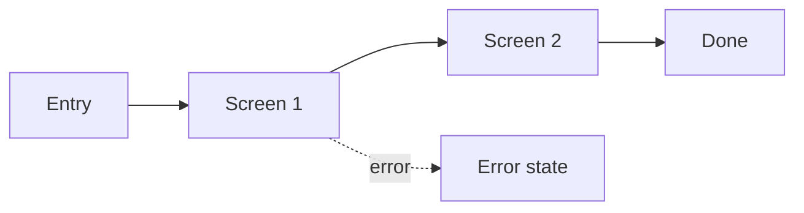

## Purpose

Write a design spec as a document with `doc_create`. Developers read it to build the design without guessing. It records behaviour, not only looks: every state, every interaction, every edge case, the tokens and the acceptance criteria. This skill is not `critique` (feedback) and not `design-brief` (the problem before design).

## Gather the inputs

1. Read the canvas first. Do not ask for what the canvas shows.
   - `get_editor_state`: the list of screens and their names.
   - `read_embed_html`: for each embed screen, the HTML. Read states, copy, colours and tokens from it.
   - `get_variables`: the design tokens (colours, spacing, type).
   - `get_screenshot`, if it is available, to check what a screen shows.
   - A repo read with `read_design_repo`: component names, so you can name things as the code does.
   - A design brief document, if one exists (`doc_list`, `doc_read`). Link to it in Overview.
2. If key facts are missing and the `ask_user` tool is in your tool list, call it ONCE with a short form for the missing facts only. Typical gaps: the user goal, the target platform and breakpoints, the data source, the error rules.
3. Never invent facts. A state that the design does not show gets the marker `[TBD: not designed]`. Do not describe it as if it exists. Put `[TBD: what is missing]` for any other missing fact.

## Output

- Write the document with `doc_create`. Title: "Design spec: [subject]", for example "Design spec: Checkout". If `doc_create` is not in your tool list, reply in chat with the same markdown.
- To update an existing spec, use `doc_list`, `doc_read`, then `doc_edit`.
- Write the document in the user's language. Translate the template headings and labels. Keep tokens, component names and string keys as they are in the code.
- Use only the markdown that the `doc_create` description allows. A table cell holds ONE line of inline text. Put multi-line content in lists under a heading.
- A `mermaid` code block renders a diagram.
- Repeat the `### Screen: [name]` block once for each screen. Delete optional sections that do not apply.
- After `doc_create`, reply in chat with 1 to 3 sentences: what the spec covers and which `[TBD]` items the developers or the user must settle.

## Template

````markdown
# Design spec: [subject]

## Overview

- **Purpose:** [what this feature does]
- **User goal:** [what the user wants to get done]
- **Brief:** [link to the design brief, or [TBD: brief link]]
- **Status:** [draft | ready for dev]

## Flow

- **Entry points:** [where the user comes from]
- **Happy path:** [steps]
- **Exits:** [where the user can leave to]



### Screen: [name]

- **Purpose:** [one sentence]
- **Layout regions:** [header, content, footer, with sizes or rules]
- **Components:** [names as in the code]
- **Content & data:** [fields, source, realistic example values]

**States**

| State | Status | Notes |
| --- | --- | --- |
| Default | covered | |
| Hover | covered | [what changes] |
| Focus | covered | [ring style] |
| Active | [TBD: not designed] | |
| Disabled | out of scope | [reason] |
| Loading | [TBD: not designed] | |
| Empty | covered | [copy] |
| Error | covered | [message, recovery] |
| Partial success | out of scope | [reason] |
| Offline | out of scope | [reason] |
| Success | covered | |
| Permission / gated | out of scope | [reason] |

**Interactions**

- [Trigger] -> [result, with timing and animation if any]

**Edge cases**

- Long text: [truncate, wrap or grow]
- Missing image: [fallback]
- Large list: [pagination, virtual scroll]
- Translations: [expansion, right-to-left]

**Accessibility notes**

- [role, label, focus target for this screen]

## Responsive behaviour

| Breakpoint | Layout change | Fixed or fluid |
| --- | --- | --- |
| < 640px | [change] | fluid |
| >= 1024px | [change] | fixed max width [px] |

Describe the layout between breakpoints too, not only at them.

## Content & strings

| Key | Text | Notes |
| --- | --- | --- |
| `checkout.pay` | Pay now | Button, max 20 characters |

## Tokens & components

| Item | Token or component | Notes |
| --- | --- | --- |
| Primary button fill | `color.accent` [hex] | |
| Card | `Card` | [variants, detached overrides and why] |

## Accessibility

- **Focus order:** [list]
- **Visible focus:** [style, contrast]
- **Roles and labels:** [list]
- **Semantic elements:** [button, nav, main, form, heading levels]
- **Touch targets:** at least 44px
- **Contrast:** [ratios checked]
- **Reading order:** [matches visual order or not]
- **User font size:** [layout survives larger text]

## Acceptance criteria

**Must have**

- Given [context], when [action], then [result].

**Nice to have**

- [item]

## Open questions for developers

- [question, owner]
````

## Writing rules

1. Document every meaningful state. Include focus and error states. Do not stop at the happy path.
2. Describe behaviour, not only looks. Write what happens on click, on submit, on failure, and how long it takes.
3. Use realistic content. Use real names, long titles, empty values, large numbers. Do not use "Lorem ipsum" or ideal data.
4. Show the layout between breakpoints. State what is fixed and what is fluid.
5. Name things as the code does. Use the token names from `get_variables` and the component names from the repo.
6. Explain every detached or custom component. Say why it differs from the library one.
7. Use real semantics. Name the element: button, link, heading level, landmark.
8. Separate must-have from nice-to-have. Mark the non-negotiables.
9. Write acceptance criteria that a tester can run. Include accessibility criteria.
10. Mark every state the design does not show as `[TBD: not designed]`. Never describe it as built.

## Mistakes to avoid

- A spec of the happy path only.
- One window size, and no word on resizing.
- Idealised content that breaks on the first real value.
- Detached components with no explanation.
- Ignoring semantics, so developers pick `div` for a button.
- A state invented from imagination and written as if designed.
- Pixel values copied by hand where a token exists.
- A flow with no exits and no error branch.

## Sources

- Figma, the designer's handbook for developer handoff: https://www.figma.com/blog/the-designers-handbook-for-developer-handoff/
- GOV.UK, develop a component or pattern (research with users, accessibility acceptance criteria): https://design-system.service.gov.uk/community/develop-a-component-or-pattern
- Synthesis for the section order and the state checklist.
