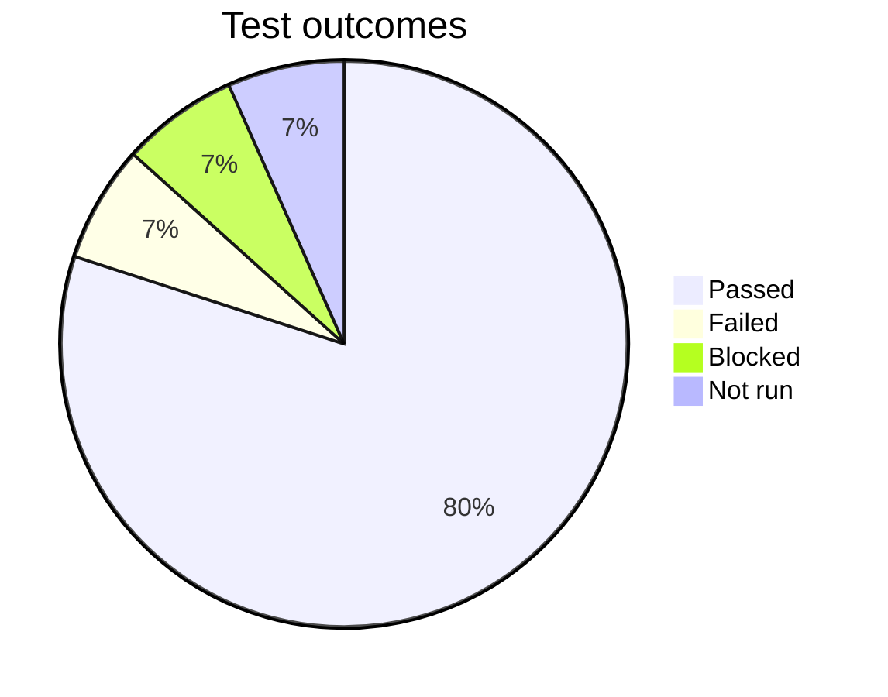
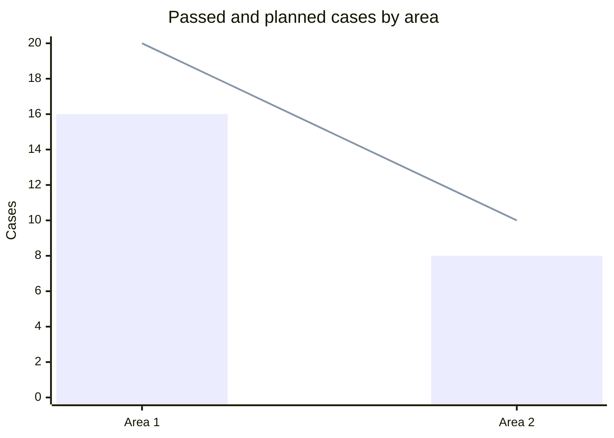

## Purpose

A test report tells the reader what was tested, what the results were and whether the build can be released. Managers and product owners read the verdict first. The team reads the numbers and the open defects. The report is written against the test plan.

## Gather the inputs

Use what the conversation already has first:

- The test plan in the document list. Call `doc_list`, then `doc_read`. Take the scope, the planned case count and the exit criteria from it.
- `browse_agent` results with `qa: true` from earlier in the conversation, for example a bug-hunt run. Use only what those results show.
- Browser runs saved in trace tabs. If `trace_list` and `trace_read` are in your tool list, read the run there: steps, console errors, failed requests and, for a QA run, its checks. A trace without QA results has no verdict.
- Bug reports already written in this conversation or in the document list.
- Results that the user pasted or attached.

Map QA scenario outcomes into the counts like this:

- `passed` goes to Passed.
- `failed`, confirmed on the rerun, goes to Failed.
- A scenario that failed and then passed on the rerun is flaky. Report it separately. It is not a failure.
- A judge downgrade (the `qa.reason` starts with "Judge:") and `inconclusive` with the reason "Agent said pass, but check failed" are not a pass. Read the failed checks and the judge reason. Count the scenario as Failed only after a rerun that confirmed it. Otherwise count it as Blocked or not run, with the reason.
- A run with `qa.unmatchedMocks` is not verified. The mock did not run. Count the scenario as not run.
- `inconclusive`, `error`, `setup_failed` and `aborted` are not a pass and not a failure. Count each one as Blocked or not run, with the reason.
- A scenario that was planned and not run goes to not run. A scenario that could not start because of a blocker goes to blocked.

Facts you need: the build under test, the environment, the dates, the planned and executed counts, the open defects.

If key facts are missing and the `ask_user` tool is in your tool list, call it ONCE with a short form for the missing facts only. Do not ask for facts you can find.

Never invent facts. Numbers must come from real results. Never invent counts, dates, names or versions. Put a visible placeholder `[TBD: what is missing]` instead. If you have no results, write the report skeleton and say that the counts are missing.

## Output

- Write the document with `doc_create`. The title is `Test report: [subject]`, for example "Test report: Checkout". If `doc_create` is not in your tool list, reply in chat with the same markdown.
- To update an existing document, use `doc_list`, `doc_read`, then `doc_edit`.
- Write in the user's language. Translate the template headings and labels. Keep IDs such as `TC-01` and `BUG-01`, and the status values, the same inside the document.
- Use only the markdown that the `doc_create` description allows. A table cell holds ONE line of inline text. Put multi-line content in lists under a heading.
- A `mermaid` code block renders a diagram.
- Write the metadata table as a property list (see the `doc_create` description). Write a date as `YYYY-MM-DD`.
- Write the verdict as a callout. The template starts with `> [!WARNING]` and `[TBD: Go / Go with conditions / No-go]`. Set the callout kind to match the verdict: Go is `> [!IMPORTANT]`, Go with conditions is `> [!WARNING]`, No-go is `> [!CAUTION]`. Then write the verdict text and the reason.
- In the two charts, the numbers are samples. Replace them with the numbers from the tables, and delete the `%%` comment line. If a number is unknown, leave the chart out.
- Link the test plan in the property list as `[Title](/doc?id={docId})` (the docId comes from `doc_list`). Link every open defect to its bug report document the same way. If no such document exists, write `[TBD: ...]` text, not a link.
- Write the exit criteria status and the defect fields as tags with fixed colours: Met green, Not met red. Severity: Critical red, High orange, Medium yellow, Low gray. Priority: P1 red, P2 orange, P3 yellow, P4 gray. Use the same tags as the bug-report and test-plan documents.
- Delete optional sections that do not apply. Do not leave empty headings.
- The H1 of the template is the `title` argument of `doc_create`. Start `markdown` after it, with the first section. The document shows the title above the body, so a `#` heading with the title in the body shows it twice.
- After `doc_create`, reply in chat with 1 to 3 sentences. Give the verdict and name the `[TBD]` items the user must fill.

## Template

````markdown
# Test report: [subject]

## Verdict

> [!WARNING]
> **[TBD: Go / Go with conditions / No-go]** [2-3 sentences: the reason. Name the blocking defects or the conditions.]

|  |  |
| --- | --- |
| Build under test | [version or build id] |
| Environment | [URL, browser, device] |
| Test period | [TBD: YYYY-MM-DD to YYYY-MM-DD] |
| Test plan | [TBD: link to the test plan] |
| Author | [TBD: name] |

## Execution results

| Planned | Executed | Passed | Failed | Blocked | Not run | Pass rate |
| --- | --- | --- | --- | --- | --- | --- |
| [N] | [N] | [N] | [N] | [N] | [N] | [passed / executed, %] |

[One sentence on how the pass rate is counted and what it means for the risk.]

**Results by area**

| Area | Planned | Passed | Failed | Blocked |
| --- | --- | --- | --- | --- |
| [Checkout] | [N] | [N] | [N] | [N] |





## Other outcomes (optional)

| Outcome | Count | Scenarios and reason |
| --- | --- | --- |
| Flaky | [N] | [failed once, passed on rerun: SC-04] |
| Inconclusive or aborted | [N] | [reason; counted as Blocked or not run] |
| Error or setup failed | [N] | [reason; counted as Blocked or not run] |

## Exit criteria

| Criterion | Status | Reason |
| --- | --- | --- |
| [100% of P1 cases passed] | [TBD: Met / Not met] | [reason, with numbers] |
| [No open Critical or High defects] | [TBD: Met / Not met] | [reason, with defect IDs] |

## Open defects

| ID | Title | Severity | Priority | Status |
| --- | --- | --- | --- | --- |
| [BUG-ID] | [TBD: link to the bug report] | [TBD: severity] | [TBD: priority] | [TBD: status] |

[Defect totals by severity: Critical N, High N, Medium N, Low N.]

## Residual risks

- [Risk: what was not covered or is unstable, and the possible impact.]

## Deviations from the plan

- [What was added, dropped or changed against the plan, and why.]
- [Not run: case IDs, and the reason.]

## Recommendations (optional)

- [Action, owner, and the reason.]
````

## Writing rules

1. Put the verdict first. The reader must know Go, No-go or Go with conditions before any table.
2. Explain every number. A pass rate without context misleads. Say what it is out of and which cases failed.
3. State the build under test and the environment exactly.
4. Report against the plan. Use the plan's scope, case list and exit criteria. Do not change them to match the results.
5. Show each exit criterion as met or not met, with a reason. The verdict follows from the criteria.
6. Show open Critical and High defects in the verdict text, not only in the table.
7. Do not hide blocked or not-run tests. Give the count and the reason for each group.
8. Report flaky scenarios (failed once, passed on the rerun) apart from failures. Count inconclusive, error, setup_failed and aborted outcomes as Blocked or not run, with the reason. Do not count any of them as bugs or as passed.
9. Use the same severity scale as the bug reports: Critical, High, Medium, Low.
10. Keep the numbers consistent. The charts and the tables use the SAME numbers. Build the charts from the tables, not from memory. Check the sums before you write:
   - Executed = Passed + Failed. A Blocked case is not executed.
   - Planned = Executed + Blocked + Not run.
   - The pie slices (Passed, Failed, Blocked, Not run) add up to Planned.
   - The rows of "Results by area" add up to the totals row. In the area chart, each `bar` value is Passed and each `line` value is Planned of the same area, in the same order as the table.
   - If a number is unknown, write `[TBD]` in the table and leave the chart out. Do not guess.
11. Keep the report short. Link to the bug reports and the plan. Do not copy them.

## Mistakes to avoid

- A verdict at the end, after a long list of results.
- Counts that were not taken from real results.
- A high pass rate with no mention of a failed Critical case.
- Counting flaky or error outcomes as failed, or as passed.
- Leaving out the not-run and blocked tests.
- Changing the exit criteria after the run so that they are met.
- Metrics with no explanation, such as "92%" alone.
- No build version, so nobody knows what was tested.

## Sources

- ISO/IEC/IEEE 29119-3 overview, test status report and test completion report: https://www.microtool.de/en/document-management/test-documentation-with-iso-iec-ieee-29119-32021/
- TestRail test summary report: https://www.testrail.com/blog/test-summary-report/
- IEEE 829 summary: https://en.wikipedia.org/wiki/Software_test_documentation
- ISTQB exit criteria set in the plan, evaluated in the report, used for the release decision: synthesis from a glossary mirror
- BrowserStack severity vs priority: https://www.browserstack.com/guide/bug-severity-vs-priority
